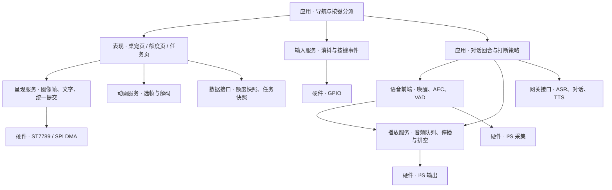

# DSPet 语音桌宠执行计划（讨论稿）

2026-11-21，工程基线 `3d3ca0f`。本稿供产品讨论和后续 AI 分阶段执行。下列交互、时长和部署位置都是建议值，待项目主人定稿。执行者接手时先核对当前 Git 状态和已完成的验收项。

## 用户拿到的第一版

建议默认采用唤醒词进入会话。叫她一声，屏幕亮出聆听反馈，你说完一句后由语音活动检测（VAD）判断句尾。她播完回答、扬声器队列排空后，自动再听下一句；等候超时就回到待机。BOOT 可作备用入口和停止播报的按键。已确认需要打断。本稿按自然语音插话设计：会话中用户直接开口，桌宠停止当前回答，把用户刚说的话作为下一轮提问。

小智固件支持唤醒词启动会话、自动模式下播完接着听，并有独立实时模式。这是 DSPet 的交互参考。DSPet 拟在板端判断句尾，截成一段再交给 DeepSeek ASR。待机唤醒在本地运行。[小智协议](https://github.com/78/xiaozhi-esp32/blob/main/docs/websocket.md) · [小智固件状态切换](https://github.com/78/xiaozhi-esp32/blob/main/main/application.cc)

一次验收示例：说「我叫小王」，听到简短中文回复；再问「我刚才说我叫什么」，能听到「小王」。断网时显示失败反馈，恢复联网后可以再次提问。角色能听懂什么、什么时候开始录、什么时候轮到人说话，应当从实物上就能判断。

## 已验证的起点

- XIAO ESP32S3 Plus、ST7789 240×240，六段动画、自动轮换、短按切换已上板。40 MHz SPI 的历史发送样本约 24 fps。见 [显示验收](validation-2026-11-17.md)。
- INMP441、MAX98357A 共用 D0/D1 时钟。D7 录音、D6 播放，已实物确认 3 秒人声清晰回放。当前启动顺序是先完成自检，再进入动画。语音和动画并行仍需验证。
- 六段动画当前约 13 MiB。仓库的 GIF 是预览，固件播放由源素材转换的压缩帧。160×160 方案属于测算，当前基线为 240×240。素材引入、署名和非商业授权见 [素材说明](../assets/README.md)。

## M0 现有固件分层

固件仍以一个 ESP-IDF main 组件构建，源码按职责归档。各目录的头文件定义跨模块契约，项目命名与中文注释规则见 [代码风格](coding-style.md)。

```text
main/
├── app_main.c           启动装配与应用循环
├── app/                 动作选择、按键与自动到期的仲裁
├── ui/                  桌宠页，组合动画帧与面板输出
├── services/
│   ├── input/           按键采样、消抖和累计按次
│   ├── animation/       选帧、解压和像素展开
│   └── audio/           PCM 播放任务、取消请求和完成事件
├── hardware/            BOOT GPIO、ST7789 面板、I²S 音频设备
└── diagnostics/         提示音、三秒录音及回放自检
```

下图是目标架构。箭头表示上层使用下层接口，事件和结果通过接口返回。当前固件用桌宠页、声音自检和按键切换跑通这些边界。额度页、任务页、导航、语音前端和网关属于后续功能。



**页面与对话分别持有状态。** 导航持有当前页，对话控制器持有会话和回合。切到额度页时，桌宠页暂停绘制；正在播放的回答和本地插话检测继续运行。返回桌宠页时依据当前对话状态选择动作。各页读取快照、提交绘制内容，由同一呈现入口使用面板。桌宠页按动画时间刷新，额度和任务页在进入或数据变更时刷新。数据服务负责异步获取和缓存，快照携带单位、更新时间以及加载或失败状态。“额度”具体指账户余额、剩余 token 配额还是已用 token，任务来自哪个系统，留待定义后接入。

**音频跨层协作。** TTS 接口接收文本、返回合成音频。播放服务将其排队并通过 I²S 输出，同时向语音前端提供与实际输出对应的 PCM 参考。前端在消除回声后报告插话；对话控制器取消旧回合并要求本地停播。提示音和录音回放自检也是音频接口的调用者。I²S 采集与输出共享一个驱动实例管理时钟和资源。

**接口审核按仓库风格执行。** 涉及模块重构时，公开函数按 `DSPet` 前缀命名，例如 `DSPetDisplayPresent`；参数如 `pixelCount`、`frameBytes` 应能看出单位。公开头文件用中文 Doxygen 说明调用上下文、缓冲区有效期和完成条件。以当前面板为例，调用成功返回时这一帧的 DMA 已结束。GPIO、I²S、SPI 与 RTOS 适配在板上验收，消抖、动作仲裁和像素展开可用主机 C11 测试。[代码风格](coding-style.md)

| 目录 | 当前实现 | 对外边界 |
| --- | --- | --- |
| hardware/ | DSPetBootPin、DSPetPanel、DSPetAudioDevice | GPIO 电平、RGB565_BE 整帧、16 kHz 单声道 PCM16。面板成功返回时 DMA 已完成；音频写入成功表示数据已排队。I²S 在同一处管理共享时钟 |
| services/input/ | DSPetButton、DSPetButtonFilter | 初始化采样任务，非阻塞读取累计有效按次；消抖接收电平及毫秒时刻，可在主机用 C11 测试 |
| services/animation/ | DSPetAnimation、DSPetIndexedFrame、DSPetClip | 输入片段、起始时刻和当前时刻，输出 RGB565_BE 帧视图与下一帧时刻。像素由动画服务持有，借用有效期到下一次取帧 |
| ui/ | DSPetPetPage | 接收应用选定的动作，取帧并通过面板接口提交像素，记录实际发送帧率 |
| app/ 和 app_main.c | DSPetActionState 及应用循环 | 应用读取按键结果并仲裁自动切换。页面按应用选定的片段绘制。后续在应用管理当前页与对话回合 |
| diagnostics/ | DSPetAudioCheck | 自检持有录音缓冲，利用同一 PCM 接口播放提示音、录音三秒并回放。尾音依据 TX DMA 完成通知确认 |

按键、动作状态、索引展开和素材测试使用 `python3 -m unittest discover -s tests/software`。固件用 `bash scripts/idf.sh build` 构建。实物验收看开机提示音、清晰的人声回放、自动轮换和 BOOT 手动切换。后续添加页面时，验证切换页面期间播报持续、插话时旧回复停止，以及切回桌宠页后显示最新对话状态。

## 接口契约 v0.2（待评审）

先约定数据方向、状态所有者、完成条件和异常行为。表中名字是讨论用的事件与命令名，实际 C 函数签名、任务数量、队列深度和 VAD 静音阈值留给实现与上板测量。

| 模块 | 接收 | 交付给谁 |
| --- | --- | --- |
| 硬件 I/O | GPIO/I²S 配置、PCM 样本、屏幕像素 | 向上报告电平、采集样本、TX 完成和显示 DMA 完成。输入服务负责消抖，播放服务关联回合 ID 并报告开始、停播和排空 |
| 语音前端（唤醒、VAD、分段） | 麦克风采样、播放参考和收音模式 | 给控制器 WakeDetected、SpeechStarted、播报时的 BargeInDetected、UtteranceReady 或等待超时。UtteranceReady 带本轮 ID、采样数和完整录音的只读所有权句柄 |
| 交互控制器 | 上述事件、网络结果、用户取消、计时器 | 唯一写会话状态；命令前端开始或停止收音，命令传输层提交或取消，命令播放器终止，向角色层发布待机、聆听、思考、说话、失败等状态 |
| 桌宠页 | 控制器发布的状态，可选音量或动画时钟 | 选取相应动作，通过动画服务获得帧并交给统一呈现入口；屏幕绘制在等待网络期间继续运行 |
| 板端传输 | SubmitTurn(session_id, turn_id, utterance) 或 CancelTurn(turn_id) | 给服务端一条完整提问；给播放器带本轮 ID 的有序回复音频块和结束标记，给控制器成功或失败事件 |
| 对话服务（建议部署在网关） | 会话 ID、回合 ID 和一句话的 PCM | 依次执行识别、带历史的对话、合成；返回可播放音频或结构化错误。开发时可用固定音频实现同一接口 |

**数据与生命周期。** v0.2 建议设备侧录音和回复音频都采用 16 kHz、单声道、PCM16LE。一次唤醒创建 session_id，同一会话每句分配新 turn_id。捕获模块在句尾交出完整录音；提交后由传输层负责在成功、失败或取消时释放。播放块在消费完成前保持有效，缓冲满时对传输施加背压。取消会关闭当前回合，清空其待播数据；后到的块和回调都按 ID 丢弃。

**先 review 这条时序。** 唤醒 → 聆听 → 收到整句 → 思考 → 第一块音频实际开始播放 → 说话 → 最后一块音频播放排空 → 同一会话继续聆听。网络响应结束时播放器可能还缓存着最后半句话，控制器等播放排空后再开下一轮。续听超时则关闭会话回待机。

**语音插话分支。** 播报时保持 RX 和 TX 同时运行，把音量处理后送给 I²S 的单声道样本作为参考，与麦克风采样按时间对齐后送给 ESP-SR。无声、欠载和停止播放时，参考信号应反映实际输出的静音。用回声消除后的音频判断近端人声；保留短环形预录，触发时将句首一并划入新回合。[ESP-SR 音频前端](https://docs.espressif.com/projects/esp-sr/en/latest/esp32s3/audio_front_end/README.html)

在“说话”状态收到 BargeInDetected，控制器使旧 turn_id 失效，就地停止送播并处理已排入 DMA 的尾音，同时异步取消网关请求。沿用 session_id，为用户插话分配新的 turn_id，屏幕切到聆听。已打断的回答在会话历史里标记为中断，以免下一轮假定用户已听完。继续使用句尾整段 ASR，停声时机由本地检测决定。

**契约验收。** 主机用假麦克风、假对话服务和假播放器驱动控制器，至少复现三种情况：同一会话连续两句使用不同回合 ID；服务已返回但喇叭仍在播放时保持说话状态；取消第一句后，其迟到音频及排空事件均不能影响第二句。真实硬件与服务分别替换对应模块后，复用相同的交互验收。

**动画先解决反馈是否看得懂。** 空闲复用六个动作；聆听、思考、说话先复用既有动作叠加明显的小图标或电平变化。体验确认后再选专属动画。继续用现有离线转换器处理 WebM；如果要让作者直接导入 GIF，单独增加 GIF 输入及时间轴验证。

## 一轮对话的数据约定

1. 设备采集 16 kHz、单声道、16 位有符号小端 PCM。以完成的录音作为一轮，建议设备向网关发送 `POST /v1/turns`，请求体为 PCM，约定格式固定；请求头携带回合 ID、会话 ID 和设备凭据。
2. 网关包装为 PCM WAV，以 multipart 的 file 字段调用 DeepSeek ASR，取得 text；空转写提示重说。官方当前提供整段识别，由 DSPet 在句尾提交完整音频。[ASR 文档](https://api-docs.deepseek.com/guides/asr/)
3. 网关将转写与近期对话发送到 Chat Completions，使用 deepseek-flash 和一份统一的角色提示。模型根据上下文把握表达节奏和长短。会话历史在网关按会话隔离，保留最近六轮，仅取最终回答正文用于播报。[对话接口](https://api-docs.deepseek.com/api/create-chat-completion/)
4. 网关向 TTS 提交回答正文和配置的音色，指定 PCM 输出。官方 PCM 为 24 kHz、16 位单声道；建议网关连续重采样为 16 kHz（跨块保留滤波状态），再按固定 PCM 格式分块返回设备。设备收到首块即可开始播放。先用整段文本的 HTTP TTS；后续按实测等待时间决定是否引入分句和 WebSocket。[TTS 文档](https://api-docs.deepseek.com/guides/tts/)
5. 建议响应通过 HTTP 状态码及机器可读错误码区分空录音、鉴权、超时和上游失败；音频开始后的连接中断按播放失败处理。每轮设总超时。有界缓存、旧回合隔离、失败退出和下一轮能恢复，作为接口验收项。密钥仅在网关环境变量中，默认日志记录耗时、长度、状态码与回合 ID。局域网开发与公网部署分别配置访问控制，公网使用 HTTPS。

**资源约束要在接网前实测。** 16 kHz PCM 每秒 32,000 字节，10 秒约 313 KiB。历史日志中播放器启动后仅余约 78 KiB 内部堆，甚至 3 秒录音也需要约 94 KiB。建议先验证板载 8 MiB PSRAM 的配置与分配，将有时长上限的录音放入 PSRAM，I²S/SPI DMA 缓冲保留内部 RAM。测 Wi-Fi、TLS 和播放同时工作时的最小剩余堆与最大可分配块。若资源紧张，备选是录音时分块传给网关，在网关组 WAV，再调用整段 ASR。降低动画素材分辨率主要节省 Flash，铺满屏幕后每帧仍需发送 115,200 字节。

## 按提交执行

### 测试目录与板载 Shell

先建立测试入口，再做 M1b。XIAO 固件通过现有 USB Serial/JTAG 运行 ESP-IDF Console，注册一个 `dspet` 命令并处理其子命令。人用串口终端输入，AI 可以通过同一个串口发送相同的命令。板上运行测试并报告结果，电脑可以保存输出。[ESP-IDF 6.0.2 Console 示例](https://github.com/espressif/esp-idf/blob/v6.0.2/examples/system/console/basic/main/console_example_main.c)

| 测试目录 | 执行和判定 |
| --- | --- |
| `tests/software/` | 主机执行纯逻辑、协议解析与素材测试。迁入现有 C11 与 Python 测试，继续支持无需接板的快速回归 |
| `tests/hardware/` | 板载命令启动设备诊断。固件根据 DMA、PSRAM、丢块和排空等证据给出判定 |
| `tests/human/` | 板载命令启动并提示操作。人通过串口提交看见或听见的结果，固件同时报告能自动取得的证据 |

首批板载命令为 `dspet help`、`dspet info`、`dspet test hardware audio duplex`、`dspet test human audio loopback` 和 `dspet test confirm <run-id> pass|fail`。耗时测试由应用或诊断任务执行，命令处理只解析参数和启动用例。完成时输出独立的结果行，包含用例、运行编号、状态和关键测量值。需要人确认的用例在收到确认前保持等待，串口脚本可以据此收集结果。音频用例通过已有设备和播放服务执行，并由应用协调资源所有权。

主机测试、串口入口、实机用例及格式化分开提交。构建配置、串口命令和复测方法见 [板载串口测试](../README.md#板载串口测试)。后续新增用例沿用同一串口结果格式，遵循 [Rules.md](../Rules.md)。

板载 Shell 用 `fd26576` 验证，修复回放增益后在 `4906512` 上复测。串口读回 `dspet info` 并启动双路自动用例，板端均报告 `pass`。两轮 RX、TX 都分别读取 1,795 和 1,796 块，两路丢块均为 0。首轮取消请求到排空为 47,957 µs。串口也验证拒绝并发测试及提前提交的人工确认。动画在测试期间持续更新。

回放用例首测中，录音里的尖峰降低了整段回放音量。改用抗尖峰的响度估计并限制输出峰值后，实物复测采到 48,000 个样本，用户确认能听清自己的声音。通过串口发送 `dspet test confirm 2 pass`，板端返回 `audio_loopback state=pass`。

本地播放演示已通过播放、BOOT 停播和重新播放的实物验证。测试固件为 `6c4f9a5`。串口记录三次取消请求到 DMA 排空间隔为 42.5、43.5、42.5 ms。此数字从应用发出取消请求算起，语音检测延迟留待后续测量。播报期间动画约 24 fps，完整自然结束事件待补采一次。复测步骤见 [本地播报与停播演示](../README.md#本地播报与停播演示)。

| 阶段 | 改动范围 | 完成证据 |
| --- | --- | --- |
| M1a 同时录放与播放参考 | 先补一次自然结束日志。在现有 I²S 共享时钟下，并行播放固定中文和采集麦克风。音频设备提供有时间依据的采样与发送信息，播放服务提供音量处理后的参考样本。验证参考何时对应实际播放，覆盖静音、尾部和停播。测当前 ESP-IDF 下的 ESP-SR 构建兼容性、模型 Flash 预算和 PSRAM 分配 | 开着动画，能读出具有稳定时间关系的麦克风与参考数据。只播放、说话重叠、取消后三个场景都有可复核的帧统计。记录丢块、帧率和剩余内部堆 |
| M1b 离线自然插话 | 从两路信号接入回声消除和人声检测。保留短预录，检测到开口后让应用复用停播接口，把插话作为一句新录音，再本地回放 | 角色单独说话时不误停。插话后能听清完整首句。建议用常用音量和正常桌面距离先测 10 次，记录成功次数、首字完整性和从开口到停声的时间。300 ms 为停声中位数的初步目标 |
| M1c 本地会话 | 接入现成中文唤醒词、句尾判断和续听超时，串起待机、聆听、等待、播报及打断状态。继续用本地回放模拟回复 | 唤醒一次后连续完成三轮。句内停顿不会过早结束，答完自动再听，超时回到待机。新回合不会收到旧回合的完成事件 |
| M2 DeepSeek 网关 | 在 Mac 上用已知中文 WAV 验证识别、对话、合成，把回复转为设备侧的 16 kHz 单声道 PCM | 看得到转写、听得到相关回答。分别测 ASR、对话、TTS 耗时，覆盖空转写、鉴权失败、限流和超时 |
| M3 设备联网 | 先连假网关播放已知音频，再换真实网关。把设备的本地停播与网关取消绑定，按回合 ID 隔离迟到数据 | 连续完成 10 轮中文问答，覆盖上下文追问、播报中插话和断网恢复。记录说完到首声的时间、最低内部堆及动画帧率 |
| M4 页面扩展 | 先用假数据实现桌宠、额度、任务三个页面的导航，再逐个确定数据来源与刷新策略 | 播报中切到额度或任务页，声音继续。插话仍能停掉旧回复，切回桌宠页能看到当前会话状态 |

M1a 的双路诊断、M1b 的离线插话和 M1c 的本地会话已经写入固件。各阶段的实机结果见下文。M2 可独立推进。M4 的假数据页面可在导航边界确认后独立推进，整体验收依赖 M3。每个实现阶段按职责拆提交，附构建或测试结果，区分串口证据和实物听感。提交说明用中文，沿用仓库已有的 `type(scope):` 格式。见 [Git 提交约定](coding-style.md#git-提交)。

**M1a 实物验证。** 2026-11-22，XIAO ESP32S3 Plus，固件 `3f306fc`。诊断开启两路 DMA 观测，使用 Octal PSRAM 40 MHz 和自动复测。以下为同一次启动的串口结果。

| 检查项 | 实测 |
| --- | --- |
| 同时录放 | 38 秒内各观测 4,750 块，序号未发现丢块。每块 128 样本，两路最大间隔为 RX 8,016 µs、TX 8,013 µs |
| DMA 完成相位 | RX 相对最近的 TX 块边界约 1.521～1.550 ms。这个数值包含 FIFO 和中断延迟，实际声学延迟需要另测 |
| 停播和自然结束 | 应用取消请求到排空确认 47.4 ms，随后确认 TX 静音。重播完整的 201,651 样本后收到自然结束事件，下一窗口参考峰值回到 0 |
| 内存 | 已识别 8 MiB PSRAM，板上 RAM 自检通过，320,000 字节录音预算可分配。诊断和动画运行期间最低内部堆 53,752 字节 |

当前采样由板端任务消费，串口记录统计值。自然插话时能否区分人声与回声属于 M1b 的验收范围。测试流程见 [双路音频采样诊断](../README.md#双路音频采样诊断)。

**M1a 的 ESP-SR 构建检查。** ESP-IDF 6.0.2 和 ESP-SR 2.6.1 用独立的 ESP32-S3 工程编译及链接 `MR` 音频前端通过。测试配置选 `CONFIG_SR_WN_WN9S_NIHAOXIAOZHI=y` 和 `CONFIG_SR_VADN_VADNET1_MEDIUM=y`，打包得到 414,016 字节模型镜像。现有 16 MiB Flash 在 15 MiB 应用分区之后还有 960 KiB，可容纳这组模型。下一阶段用 DSPet 合并构建复核实际代码体积与运行内存。这个检查使用独立工程，板上双路诊断采用现有 DSPet 分区。参考 [小智音频模块](https://github.com/78/xiaozhi-esp32/blob/main/main/audio/README.md) 和 [ESP-SR 2.6.1](https://components.espressif.com/components/espressif/esp-sr/versions/2.6.1/readme)。

**M1b 延迟测量基线。** 2026-11-22 使用 XIAO ESP32S3 Plus，固件 `c8dc97a`。通过串口执行 `dspet test hardware audio alignment`。每次播放三段 128 ms 短扫频，取实际 TX 采样作为参考，通过去直流的归一化互相关定位回录里的匹配点，再用两路 DMA 时间基准换算延迟。四次命令共测 12 轮，包含一次人工拔插 USB 后复测。延迟为 2,097～2,098 µs，相关系数为 0.645～0.781，四次均返回 `pass`。同一配置下，后续 AEC 可以从约 2.10 ms 开始校准。这个估计随硬件、音量和摆放变化，包含换能器及 DMA 时间基准影响，微秒输出保留计算结果，采样间隔为 62.5 µs。批量相关计算会暂时降低刷帧速度，作为诊断用例运行。自然插话和回声消除仍是接下来的 M1b 工作。

**M1b 的 AEC 板载验收。** 2026-11-22 使用固件 `8f1df78`，从串口执行 `dspet test hardware audio aec` 两次，均返回 `pass`。每轮使用同一段中文和同一段回录窗口，在实测约 2.10 ms 路径下为参考保留 1.00 ms 滤波前量。硬件层提供 DMA 观测，音频服务按共享采样时钟对齐并调用 ESP-SR 2.6.1 FD Low Cost，实机用例负责播放和统计。参考 [ESP-SR AEC 文档](https://docs.espressif.com/projects/esp-sr/en/latest/esp32s3/acoustic_echo_cancellation/README.html)。

| 轮次 | 处理前 / 后 RMS | 抑制量 | 最长处理 / 帧预算 | 丢块 | 最低内部堆 |
| --- | --- | --- | --- | --- | --- |
| 1 | 86.7 / 27.1 | 10.11 dB | 16.286 / 32 ms | 0 | 21,352 B |
| 2 | 86.3 / 20.7 | 12.42 dB | 15.468 / 32 ms | 0 | 21,336 B |

最初两轮测得 9.63 和 10.57 dB，但短促的声响或输入尖峰抬高了整段底噪 RMS，资格检查返回 `fail`。修正版保留整段 RMS，改用底噪帧 RMS 中位数检查环境。在通过的第一轮里，底噪 RMS 为 68.3，帧中位数为 40.6。诊断移动到 CPU1 后，复测播报期间动画为约 24 fps。原有双路测试复跑通过，RX/TX 丢块均为 0。本次是设备独自播报的实测，下一阶段用同时说话的场景验证人声保留和自然插话。

**M1b 自然插话原型。** 硬件层提供 I²S 收发与 DMA 时间戳。音频服务对齐两路 PCM、去除回声，并判断开口和句尾。应用层收到开口事件后调用播放取消接口，保留约 320 ms 的预录并继续录完这一句。板载 Shell 负责发起固定播报、回放录音和记录人工确认。复测步骤见 [板载串口测试](../README.md#板载串口测试)。

首次键盘测试触发了误停。开口判定仍需连续 4 帧命中，调整后要求这段连续命中里至少有一帧限幅 RMS 达到 110。插话成立后使用较低的能量门限续录，连续 700 ms 安静后结束，保留其中 400 ms 尾音。首轮提高开口门限后录音只有 0.60 秒，用户确认停播，未确认回放。

| 场景 | 固件 | 串口结果 | 实物反馈 |
| --- | --- | --- | --- |
| 安静播报 | `60fa82b` | `pass`，自然结束，丢块 0，峰值 RMS 65.1 | 板端自动判定 |
| 键盘干扰 | `6004eaf` | `pass`，自然结束，丢块 0，峰值 RMS 98.9 | 用户确认正常打字、播报完整 |
| 自然插话 | `60fa82b` | `pass`，取消至 DMA 排空 41.11 ms，预录 5,120 样本，丢块 0 | 用户确认停播后回放整句，首尾清楚 |

`60fa82b` 的调整只作用于已确认开口后的续录判定。该版插话回放达到 64,000 样本的 4 秒上限，尚需在多种环境下验证自然句尾收束。41.11 ms 从应用发出取消请求开始计时，开口到停声的总延迟待测。复测期间动画约 24 fps。

**M1c 本地会话。** 唤醒服务在待机时只在板上识别「你好小智」。聆听与播报共用已对齐的麦克风和播放参考，句尾由音频服务判断。应用层用回合编号组织录音、固定回复、播放完成和插话，显示层按状态选择动作。模型镜像约 284 KiB，存放在独立的 960 KiB 分区。动画差分解码使用的上一帧索引移到 PSRAM，为唤醒库和 I²S 留出内部 RAM。

2026-11-22 最终测试固件 `cb721dc` 通过串口自动用例 `voice_timeout_and_release`。静默后返回待机，关闭语音后双路诊断自然结束，RX/TX 丢块均为 0，诊断结束后恢复唤醒。另一次串口启动的会话收到 21,120 样本（1.32 秒，未达上限），回复自然播完并回到聆听。主机测试覆盖正常换轮、插话换轮、丢弃旧回合事件和待机超时。

独立真人用例 `voice_session_serial` 返回通过。一次唤醒后共四次收录，时长约为 1.22、1.16、3.22、2.34 秒，均在 4 秒上限前结束。串口记录两次插话取消、两次播完自动续听，最后约 8 秒未开口后回到待机。用户确认第一次停播发生在本人开口之后。取消请求到 DMA 排空分别为 47.31 ms 和 42.54 ms。500 ms 句内停顿已有主机测试覆盖，实物听感单独确认。前面同时含 Mac 测试音和真人输入的记录只用于排查。会话运行期间抽样到约 21～23 fps，测试固件应用分区剩余约 620 KiB。复测步骤见 [本地语音会话](../README.md#本地语音会话)。

**M2 Mac 语音网关。** 2026-11-22 用三段合成中文 WAV 实测连续问答。DeepSeek 正确算出苹果剩七个，转写把「小鲸鱼」听成「小金鱼」，随后故事续讲保留了上一轮的人物。提示词统一约定按意图决定长短，日常和故事沿用同一处理流程。网关在收取 TTS PCM 时连续重采样，并通过分块传输交付音频。另一路真实 HTTP 测试从 Mac 本地发出请求，4.49 秒收到首批 16 kHz PCM，13.25 秒收完整段 49.80 秒的故事音频。网关接口、启动命令及模拟上游测试见 [Mac 语音网关](../README.md#mac-语音网关)。板端 Wi-Fi、喇叭实听和说完到首声的耗时留在 M3 实测。

**M3 无网关直连实机探针。** XIAO ESP32S3 Plus 在 2.4 GHz 信道 11 加入家庭网络，直接通过 TLS 访问 DeepSeek 对话与 TTS，两种长度的固定问题均有一次完整验证通过。Mac 串口负责触发、临时配置凭据和提供时间。板端校验服务端证书，将 24 kHz 合成 PCM 转成 16 kHz，收完整段音频后通过 I²S 播放并排空。

| 用例 | 首批 PCM 排入 I²S | 已播时长 | 回合结束 | 内部堆最低值 |
| --- | --- | --- | --- | --- |
| 一字回复「二」 | 6.81 秒 | 0.76 秒 | 7.60 秒 | 67,584 B |
| 普通一句回复 | 16.33 秒 | 7.24 秒 | 23.60 秒 | 52,872 B |

耗时从发出对话请求开始，不计加入网络的时间。现场信号约 −80 dBm，较早的试验遇到关联失败、HTTPS 超时和音频传输被重置。测试版将动画解码帧移到 PSRAM，播报期间动画约 9～13 fps，应用分区剩余约 404 KiB。TLS 使用软件 SHA/AES 后通过证书校验，相关现象见 [ESP-IDF #18640](https://github.com/espressif/esp-idf/issues/18640)。串口复测见 [XIAO 直连 DeepSeek 验证](../README.md#xiao-直连-deepseek-验证)。接下来要把板端录音交给 ASR，并验证持续下载与 DMA 播放在实际多轮会话中的表现。

**M3 直连会话实测。** 音频任务收录 16 kHz PCM 并消回声，网络任务持有录音副本、HTTPS 和上一轮上下文，播放任务分块取样。ASR 用 8 kHz WAV 减少弱网下的上传量，TTS 转回 16 kHz，使用 64 KiB PSRAM 缓冲，积累约 1 秒音频后可开始播放。屏幕用 30 行 DMA 缓冲，为同时运行的网络和音频任务释放约 98 KiB 内部 RAM。此次联网播报期间的动画帧率仍低于离线模式。

安静用例用板载样本取得真实 ASR 转写，TTS 收完前开始播报，完整播放 125,440 个样本并续听。约 −82 dBm 下记录到 10 次重新缓冲。两次串口受控插话中，旧回合分别在取消请求后约 47.34 ms 和 43.33 ms 排空，网络任务标记取消并关闭连接，随后提交新编号的录音。一次新回合写出完整 WAV 后等待 ASR 响应超时，另一次在约 −84 dBm 下遇到 beacon 超时，写出 20,647 / 32,199 字节后失败。两次设备均恢复聆听。真人监听的等待窗口未收到唤醒事件。复测入口见 [直连语音会话](../README.md#直连语音会话)。

**真人试听与缓冲修正。** BOOT 发起聆听后，实际麦克风录音识别为「讲一个小故事」，设备在收到整段音频前开始播报。随后一个完整流播回合收取了 339,840 字节的 24 kHz PCM，用时 22.57 秒，音频本身为 7.08 秒，播放记录 8 次缓冲耗尽。用户听到一句话在字中间停顿。改用 2 MiB 的 PSRAM 环形缓冲，接收达到实时速率并积累约两秒音频后才开始流播。较慢时等待完整回复，缓冲接近上限时允许提前消费。回声消除在实际播报时重新对齐，网络与音频任务运行在不同核心。主机用例覆盖接收速率不足、完整短答和缓冲快满三个开播条件。新版实机复测时信号约 −89 dBm，板子未取得 IP，改版后的真人试听待联网后补测。

**接入天线后复测。** `HunZiHome` 的扫描 RSSI 从 −92 dBm 改善到 −36 dBm，后续实测关联约 −54 dBm。固件在网络等待时继续消费 DMA 观测并保持对齐，播放时若观测断开可重新对齐。板载样本的 4.16 秒音频从第一批到完整接收约用时 2.53 秒，边收边播完整结束，缓冲耗尽 0 次。随后用麦克风说「一加一等于几」，ASR 用时约 1.59 秒，回复在 TTS 结束前开始播放，缓冲耗尽 0 次并正常续听。用户确认「二」完整说出。这轮仍有 DMA 观测重对齐和一次 CPU0 空闲任务看门狗告警，播放完成事件已收到。

## 讨论后再定稿

- **部署**：首版能否依赖同一 Wi-Fi 下的 Mac？开发建议本地网关。如果要求接电联网就能用，同一服务可部署到常在线服务器；如果要求纯设备直连，则重新评估密钥、TLS 内存、上下文和音频格式处理。
- **免按键体验**：建议第一版做到叫一次、轮流聊多句。已要求支持打断，本稿假定自然插话；待确认目标距离、常用音量与 BOOT 备用行为。先使用支持的唤醒词验证，自定义角色名需单独确认模型支持。
- **角色体验**：先用普通话简短回答；音色通过同一句话试听决定。是否需要字幕、长期记忆和专属聆听/说话动作，按第一轮实物体验安排。

DeepSeek 接口核对日期为 2026-11-21。全家桶已提供独立的 ASR 和 TTS，后续实现时复核上游接口与账号可用性。[官方发布说明](https://api-docs.deepseek.com/zh-cn/news/news261113/)
