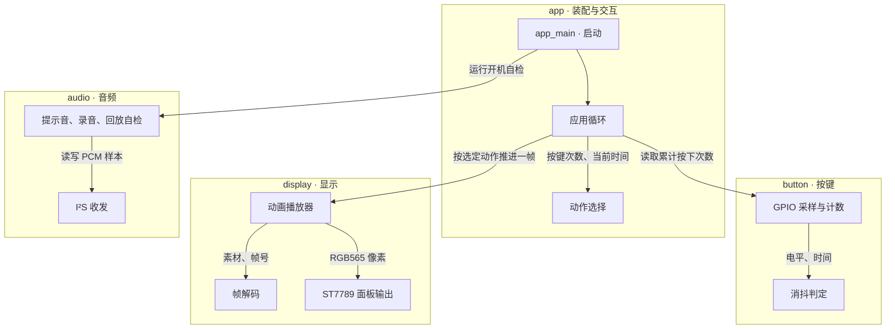

# DSPet 语音桌宠执行计划（讨论稿）

2026-11-21，工程基线 `3d3ca0f`。本稿供产品讨论和后续 AI 分阶段执行。下列交互、时长和部署位置都是建议值，待项目主人定稿。执行者接手时先核对当前 Git 状态和已完成的验收项。

## 用户拿到的第一版

建议默认采用唤醒词进入会话。叫她一声，屏幕亮出聆听反馈，你说完一句后由语音活动检测（VAD）判断句尾。她播完回答、扬声器队列排空后，自动再听下一句；等候超时就回到待机。BOOT 可作备用入口和停止播报的按键。已确认需要打断。本稿按自然语音插话设计：会话中用户直接开口，桌宠停止当前回答，把用户刚说的话作为下一轮提问。

小智固件支持唤醒词启动会话、自动模式下播完接着听，并有独立实时模式。这是 DSPet 的交互参考。DSPet 拟在板端判断句尾，截成一段再交给 DeepSeek ASR。待机唤醒在本地运行。[小智协议](https://github.com/78/xiaozhi-esp32/blob/main/docs/websocket.md) · [小智固件状态切换](https://github.com/78/xiaozhi-esp32/blob/main/main/application.cc)

一次验收示例：说「我叫小王」，听到简短中文回复；再问「我刚才说我叫什么」，能听到「小王」。断网时显示失败反馈，恢复联网后可以再次提问。角色能听懂什么、什么时候开始录、什么时候轮到人说话，应当从实物上就能判断。

## 已验证的起点

- XIAO ESP32S3 Plus、ST7789 240×240，六段动画、自动轮换、短按切换已上板。40 MHz SPI 的历史发送样本约 24 fps。见 [显示验收](validation-2026-11-17.md)。
- INMP441、MAX98357A 共用 D0/D1 时钟。D7 录音、D6 播放，已实物确认 3 秒人声清晰回放。当前启动顺序是先完成自检，再进入动画。语音和动画并行仍需验证。
- 六段动画当前约 13 MiB。仓库的 GIF 是预览，固件播放由源素材转换的压缩帧。160×160 方案属于测算，当前基线为 240×240。素材引入、署名和非商业授权见 [素材说明](../assets/README.md)。

## M0 先整理现有固件（结构建议，待评审）

顶层按功能找代码。建议在同一个 ESP-IDF main 组件里建立 button/、display/、audio/、app/；main/app_main.c 作为装配入口。每个功能内部按变化原因和测试边界拆文件，同一个目录中的私有函数和数据尽量保留在使用它们的文件里。

下图是 M0 的目标调用关系。每根箭头从调用方指向被调用方，线上文字描述这次调用的用途。方框表示可单独解释和测试的职责；相邻职责可以共用一个实现文件。

**以 BOOT 切换动作为例。** 按键模块累积有效按下次数，应用循环取出次数并调用动作选择逻辑，得到片段编号。播放器依据片段和时间请求解码，取回像素交给面板。改 BOOT 的用途时从 app 入手；改关键帧格式时从解码器入手；查颜色或偏移时从面板入手。现有 `pet_animation.c` 中的 `pet_play()` 同时承担这几步，第一次拆分可从移出按键读取和动作选择开始。

**接口审核按仓库风格执行。** 涉及模块重构时，公开函数按 `DSPet` 前缀命名，例如 `DSPetDisplayPresent`；参数如 `pixelCount`、`frameBytes` 应能看出单位。公开头文件用中文 Doxygen 说明调用上下文、缓冲区有效期和完成条件。以当前面板为例，调用成功返回时这一帧的 DMA 已结束。GPIO、I²S、SPI 与 RTOS 适配在板上验收，消抖、动作仲裁和像素展开可用主机 C11 测试。[代码风格](coding-style.md)

| 功能与内部职责 | 现有代码怎么落位 | 对外输入、输出及所有权 |
| --- | --- | --- |
| button：采样与消抖 | button.c 管 GPIO0、10 ms 采样和 FreeRTOS 队列；button_filter.c 管电平稳定时间、重新武装与按住不重复 | 输入物理电平与时间，向 app 报告有效按下。M0 保留累计次数语义，跨多次采样仍能还原快速连按。换动作由 app 决定 |
| display：屏幕输出 | display.c 作为 ST7789 面板实现，集中管理 SPI、背光、复位、DMA 缓冲和完成回调 | 输入 RGB565_BE 像素，发送完成后返回；仅面板实现接触 esp_lcd 和显示 DMA |
| display：帧解码 | 从 pet_animation.c 提取 zlib、关键帧定位、差分重建，与已有 indexed_frame.c 配合；pet_clip.h 描述素材，转换工具仍在 tools/ | 输入片段和目标帧号，输出 RGB565_BE 帧视图。解码器拥有缓冲，帧视图到下次解码前有效 |
| display：动画播放 | 从 pet_animation.c 保留时间到帧号的换算、跳帧、切片段时重置解码状态、性能统计及调用面板 | app 指定 clip 与开始时间，播放器按时绘制。app 可以换片，播放器无需了解换片的触发源 |
| audio：I²S 与 PCM | 从 audio_check.c 提取 I²S 配置与释放、采集左槽、单声道写双槽、等待已排队音频播完 | 音频接口对上层使用 16 kHz 单声道 PCM16 样本与样本数，对内管理 32 位立体声槽和设备句柄。读写失败返回错误及已处理数量或明确的整块失败 |
| audio：自检流程 | audio_check.c 保留提示音、3 秒录音、统计、限幅回放及异常清理 | 自检拥有本次录音，复用 PCM 接口，结束后释放。可用已知样本在主机测提取、双槽映射和限幅 |
| app：交互与装配 | action_state.c 放在 app/，保留按键与自动到期的仲裁；将 pet_play() 中轮询按键、决定动作的部分移到 app 主循环。app_main.c 组装模块并启动 | app 是唯一把“按下/到期”解释成“播放哪个动作”的调用者；button、display、audio 各自只包含自己的依赖 |

一次正常路径是 GPIO0 有效按下 → button 更新累计数 → app/action_state 选下一段 → display 播放器选帧 → 解码器还原像素 → panel 完成 DMA。音频诊断路径由 app 启动，audio 自检产生 PCM 并用同一 I²S 接口录放。

**提交及验收顺序。** ① 归拢 button 和既有消抖测试，核对按住、抖动、快速连按。② 把选动作从播放器移给 app，复跑按键与自动到期重合的测试。③ 分离帧解码和呈现，核对切换时第一帧、跳帧差分及回绕，实机比较六段动画与已有约 24 fps 基线。④ 提取 audio 的 I²S/PCM 接口，复验提示音、3 秒人声回放及结束后恢复动画。每笔迁移同步改 CMake 和主机测试里的路径，确保能独立构建。现有主机测试用 python3 -m unittest discover -s tools 运行。M0 验收后再进入下面的语音功能阶段。

## 接口契约 v0.2（待评审）

先约定数据方向、状态所有者、完成条件和异常行为。表中名字是讨论用的事件与命令名，实际 C 函数签名、任务数量、队列深度和 VAD 静音阈值留给实现与上板测量。

| 模块 | 接收 | 交付给谁 |
| --- | --- | --- |
| 硬件 I/O | 音频采集配置、带回合 ID 的播放块与结束标记、屏幕像素 | 给语音前端连续的 16 kHz 单声道 PCM16 和带采样位置的播放参考；给控制器消抖后的按键事件、实际开始播放及播放排空事件；给渲染器 DMA 完成通知 |
| 语音前端（唤醒、VAD、分段） | 麦克风采样、播放参考和收音模式 | 给控制器 WakeDetected、SpeechStarted、播报时的 BargeInDetected、UtteranceReady 或等待超时。UtteranceReady 带本轮 ID、采样数和完整录音的只读所有权句柄 |
| 交互控制器 | 上述事件、网络结果、用户取消、计时器 | 唯一写会话状态；命令前端开始或停止收音，命令传输层提交或取消，命令播放器终止，向角色层发布待机、聆听、思考、说话、失败等状态 |
| 角色表现 | 控制器发布的状态，可选音量或动画时钟 | 选取相应动作，解码素材并向显示驱动送帧；屏幕绘制在等待网络期间继续运行 |
| 板端传输 | SubmitTurn(session_id, turn_id, utterance) 或 CancelTurn(turn_id) | 给服务端一条完整提问；给播放器带本轮 ID 的有序回复音频块和结束标记，给控制器成功或失败事件 |
| 对话服务（建议部署在网关） | 会话 ID、回合 ID 和一句话的 PCM | 依次执行识别、带历史的对话、合成；返回可播放音频或结构化错误。开发时可用固定音频实现同一接口 |

**数据与生命周期。** v0.2 建议设备侧录音和回复音频都采用 16 kHz、单声道、PCM16LE。一次唤醒创建 session_id，同一会话每句分配新 turn_id。捕获模块在句尾交出完整录音；提交后由传输层负责在成功、失败或取消时释放。播放块在消费完成前保持有效，缓冲满时对传输施加背压。取消会关闭当前回合，清空其待播数据；后到的块和回调都按 ID 丢弃。

**先 review 这条时序。** 唤醒 → 聆听 → 收到整句 → 思考 → 第一块音频实际开始播放 → 说话 → 最后一块音频播放排空 → 同一会话继续聆听。网络响应结束时播放器可能还缓存着最后半句话，控制器等播放排空后再开下一轮。续听超时则关闭会话回待机。

**语音插话分支。** 播报时保持 RX 和 TX 同时运行，把音量处理后送给 I²S 的单声道样本作为参考，与麦克风采样按时间对齐后送给 ESP-SR。无声、欠载和停止播放时，参考信号应反映实际输出的静音。用回声消除后的音频判断近端人声；保留短环形预录，触发时将句首一并划入新回合。[ESP-SR 音频前端](https://docs.espressif.com/projects/esp-sr/en/latest/esp32s3/audio_front_end/README.html)

在“说话”状态收到 BargeInDetected，控制器使旧 turn_id 失效，就地停止送播并处理已排入 DMA 的尾音，同时异步取消网关请求。沿用 session_id，为用户插话分配新的 turn_id，屏幕切到聆听。已打断的回答在会话历史里标记为中断，以免下一轮假定用户已听完。继续使用句尾整段 ASR，停声时机由本地检测决定。

**契约验收。** 主机用假麦克风、假对话服务和假播放器驱动控制器，至少复现三种情况：同一会话连续两句使用不同回合 ID；服务已返回但喇叭仍在播放时保持说话状态；取消第一句后，其迟到音频及排空事件均不能影响第二句。真实硬件与服务分别替换对应模块后，复用相同的交互验收。

**动画先解决反馈是否看得懂。** 空闲复用六个动作；聆听、思考、说话先复用既有动作叠加明显的小图标或电平变化。体验确认后再选专属动画。继续用现有离线转换器处理 WebM；如果要让作者直接导入 GIF，单独增加 GIF 输入及时间轴验证。

## 一轮对话的数据约定（提议）

1. 设备采集 16 kHz、单声道、16 位有符号小端 PCM。以完成的录音作为一轮，建议设备向网关发送 `POST /v1/turns`，请求体为 PCM，约定格式固定；请求头携带回合 ID、会话 ID 和设备凭据。
2. 网关包装为 PCM WAV，以 multipart 的 file 字段调用 DeepSeek ASR，取得 text；空转写提示重说。官方当前提供整段识别，由 DSPet 在句尾提交完整音频。[ASR 文档](https://api-docs.deepseek.com/guides/asr/)
3. 网关将转写与近期对话发送到 Chat Completions，建议默认模型 deepseek-flash，可配置。中文角色提示约定每次先答一两句。会话历史在网关内存按设备和会话隔离，限制轮数，仅取最终回答正文用于播报。[对话接口](https://api-docs.deepseek.com/api/create-chat-completion/)
4. 网关向 TTS 提交回答正文和配置的音色，指定 PCM 输出。官方 PCM 为 24 kHz、16 位单声道；建议网关连续重采样为 16 kHz（跨块保留滤波状态），再按固定 PCM 格式分块返回设备。设备收到首块即可开始播放。先用整段文本的 HTTP TTS；后续按实测等待时间决定是否引入分句和 WebSocket。[TTS 文档](https://api-docs.deepseek.com/guides/tts/)
5. 建议响应通过 HTTP 状态码及机器可读错误码区分空录音、鉴权、超时和上游失败；音频开始后的连接中断按播放失败处理。每轮设总超时。有界缓存、旧回合隔离、失败退出和下一轮能恢复，作为接口验收项。密钥仅在网关环境变量中，默认日志记录耗时、长度、状态码与回合 ID。局域网开发与公网部署分别配置访问控制，公网使用 HTTPS。

**资源约束要在接网前实测。** 16 kHz PCM 每秒 32,000 字节，10 秒约 313 KiB。历史日志中播放器启动后仅余约 78 KiB 内部堆，甚至 3 秒录音也需要约 94 KiB。建议先验证板载 8 MiB PSRAM 的配置与分配，将有时长上限的录音放入 PSRAM，I²S/SPI DMA 缓冲保留内部 RAM。测 Wi-Fi、TLS 和播放同时工作时的最小剩余堆与最大可分配块。若资源紧张，备选是录音时分块传给网关，在网关组 WAV，再调用整段 ASR。降低动画素材分辨率主要节省 Flash，铺满屏幕后每帧仍需发送 115,200 字节。

## 按提交执行

| 阶段 | 改动范围 | 完成证据 |
| --- | --- | --- |
| M1 本地免按键交互 | 提取音频能力并验证 PSRAM。用 ESP-SR 在 S3 上试一个现成的中文唤醒词，再接 VAD、短音频预缓冲和限时录音；先以本地回放模拟回答。测唤醒模型所需分区、内部堆和动画帧率 | 连续三轮只唤醒一次。首字完整、句内短暂停顿能继续说、每句只提交一次；回放不会触发下一轮，等候超时能回待机。记录正常桌面环境下误唤醒和漏听的表现 |
| M1b 离线语音打断 | 播固定中文句子，同时采集麦克风与播放参考，接入 AEC、近端语音检测、预录和本地取消。先用 BOOT 单测取消链路，再用人声触发同一路径 | 以实际桌面距离、低和常用音量测试。仅播报时统计误停；在句首、中间、结尾各插话，记录成功率、从用户开口到扬声器停声的延迟和新句首字完整性。建议初验每档音量插话 10 次至少成功 9 次、停声中位数 ≤300 ms，每档独播 2 分钟无误停；同步记录动画 fps、音频丢块和最低堆。以上为目标值，待实测 |
| M2 网关单独验证 | 用短中文 WAV 和假的上游响应先打通 ASR、Chat、TTS 适配，再使用配置的 DeepSeek 账号做一次真实调用。开发时用命令行把结果保存为 WAV 试听 | 同一轮得到正确转写、相关中文回答和可听语音。覆盖空转写、鉴权失败、限流和超时；记录三个上游阶段耗时 |
| M3 设备通信 | 设备按约定连接网关。先让测试网关返回已知 PCM，验证格式、首包、分块、尾块和播放排空，再切换到真实 DeepSeek | 实机播放速度、音高正确；断网或中途取消可回到待机；迟到回包不会播进下一轮 |
| M4 整体验收 | 绑定三种交互动画、会话上下文与失败反馈，串起完整用户流程 | 连续完成 10 轮中文问答，含一次上下文追问、一次中止播放、一次断网恢复；记录说完到首声的中位数及最慢值、动画发送 fps、最低内部堆，留一份实机记录 |

M1 与 M2 可在确认接口后独立推进，M3 依赖两者，M4 依赖 M1b 和 M3，包含真实 TTS 播报中直接插话及旧回复迟到的端到端验证。每个阶段内也可以分小提交，例如唤醒检测、语音分段、状态接入分别 review。实现 AI 接单时读取本计划、README 和相关旧代码，只执行指定阶段，保留用户未提交的修改；交付 commit、测试命令、实测结果及仍需人耳或屏幕确认的项目。真实 API 和实物测试的结果单独标明。

## 讨论后再定稿

- **部署**：首版能否依赖同一 Wi-Fi 下的 Mac？开发建议本地网关。如果要求接电联网就能用，同一服务可部署到常在线服务器；如果要求纯设备直连，则重新评估密钥、TLS 内存、上下文和音频格式处理。
- **免按键体验**：建议第一版做到叫一次、轮流聊多句。已要求支持打断，本稿假定自然插话；待确认目标距离、常用音量与 BOOT 备用行为。先使用支持的唤醒词验证，自定义角色名需单独确认模型支持。
- **角色体验**：先用普通话简短回答；音色通过同一句话试听决定。是否需要字幕、长期记忆和专属聆听/说话动作，按第一轮实物体验安排。

DeepSeek 接口核对日期为 2026-11-21。全家桶已提供独立的 ASR 和 TTS，后续实现时复核上游接口与账号可用性。[官方发布说明](https://api-docs.deepseek.com/zh-cn/news/news261113/)
